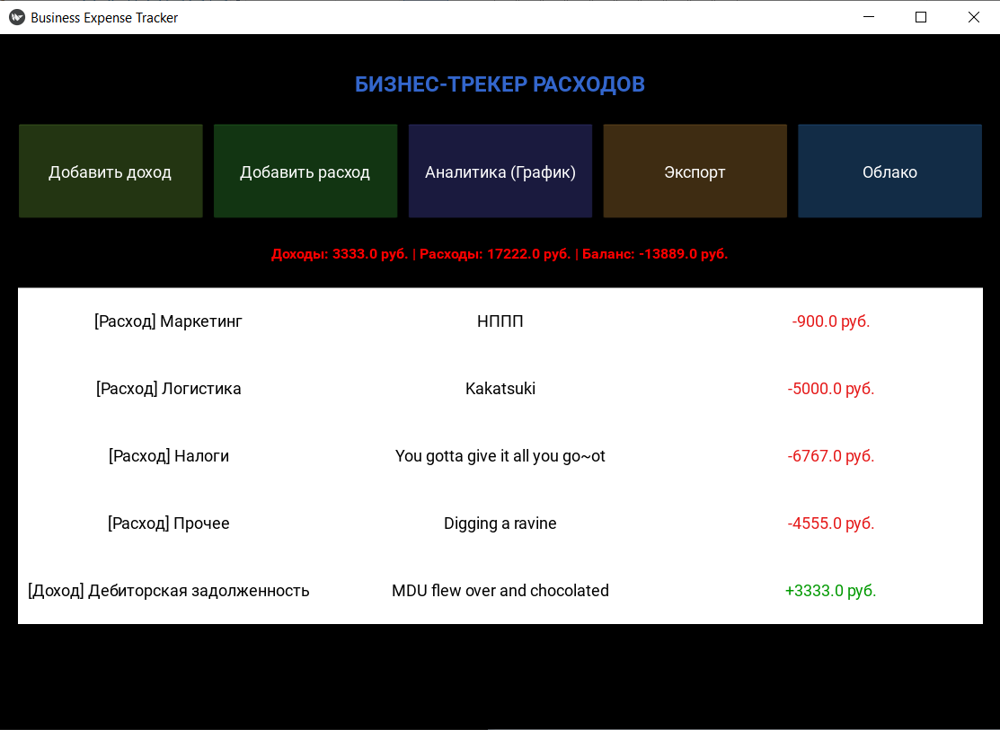
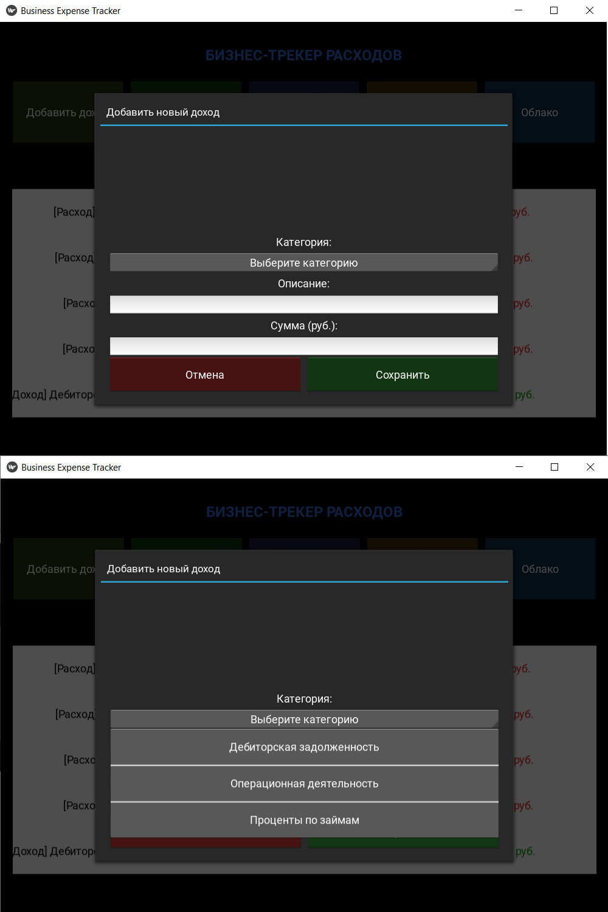
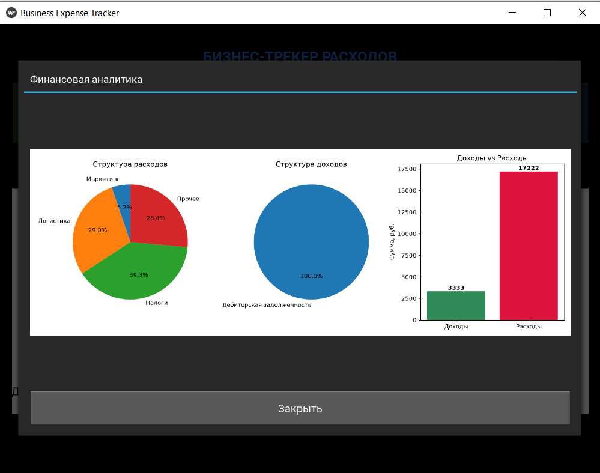
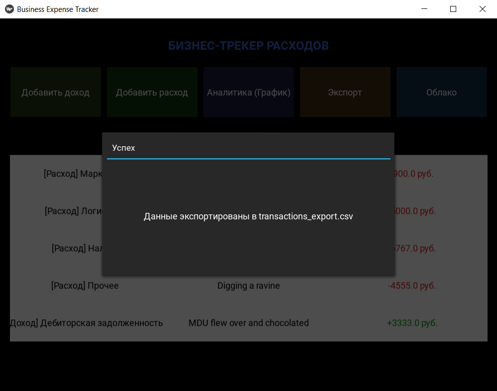
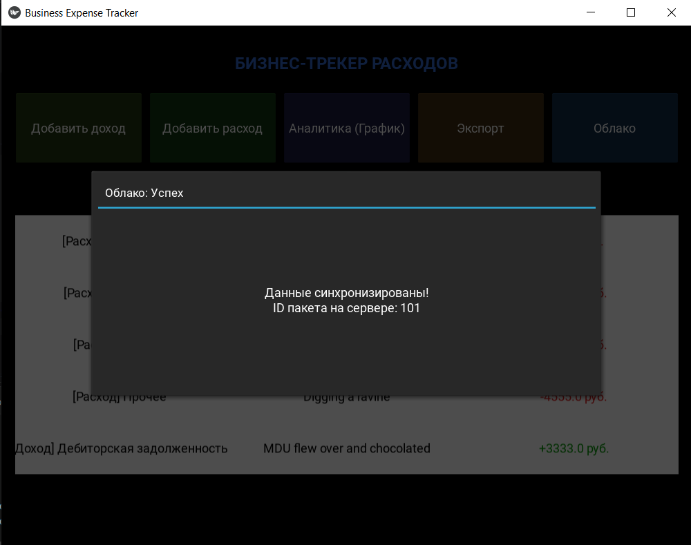

# Разработка мобильного приложения
## Задание к лекции 6

### Дополнить трекер расходов компании, используя фреймворк Kivy
1. Добавить графики matplotlib
2. Реализовать синхронизацию с облаком
3. Добавить категории расходов в баланс

### Реализация

#### Главная страница приложения

#### Добавление доходов

#### Построение графиков

#### Экспорт в файл

#### Синхронизация с облаком
_Примечание: поскольку не настроены ключи для интеграции в файле .env, запрос возвращает фиктивный ответ от typicode._

